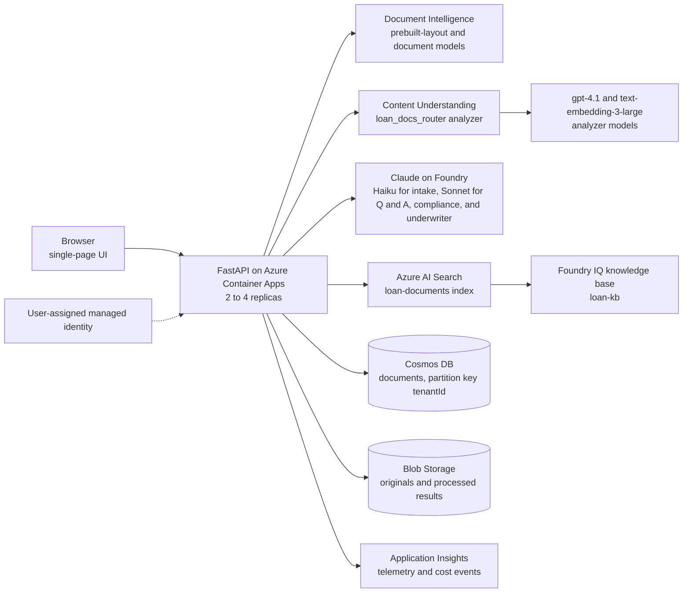

# Loan Document Intelligence on Microsoft Foundry

## About

A FastAPI app for intelligent document processing (IDP) on loan applications. It takes a **merged loan-application PDF** (paystub, bank statement, W-2, passport, driver's license), splits it into documents, extracts the fields, answers questions about the packet, and runs an underwriting review that ends in a human decision. It runs on Azure Container Apps and uses **Azure AI Document Intelligence (DI)**, **Azure Content Understanding (CU)**, **Claude** agents, and **Azure AI Search with a Foundry IQ knowledge base** on **Microsoft Foundry**.

It is a reference implementation for teams evaluating these services for a lending workflow. **Status: demo.** It uses synthetic data only and has no sign-in. Read [Known limitations](#known-limitations) and [Security and data handling](#security-and-data-handling) before you use it for anything else.

## Features

The demo covers:

- Multi-document PDF splitting (heuristic DI layout, or the Content Understanding router)
- Document library: upload, list, process, delete, scoped by the `x-tenant-id` header
- Example packets: open pre-computed sample packets in the library, run them live, or compare Heuristic and CU live
- Ask the agent about one packet (answers cite segments `[S#]` and policy passages `[P#]`)
- Ask the library across packets (Foundry IQ knowledge base plus direct index search)
- Three-agent underwriting review (Intake, Compliance, Underwriter) with a human decision step
- Per-tenant page-count + cost telemetry for SaaS cost allocation
- Agent telemetry: one App Insights span per agent run and Claude call, with token counts and no prompt or output text
- Compare mode (heuristic vs Content Understanding) with cost and latency; nothing is saved
- Architecture diagrams in the UI (Architecture button)

> **Demo only.** There is no sign-in. The app and API are public, and the library is scoped only by the `x-tenant-id` header (the UI defaults to tenant `demo`). Use synthetic loan documents only. See [Security and data handling](#security-and-data-handling).

### Use cases
- Data extraction from paystubs, bank statements, W-2s, tax returns
- Document classification + routing of merged PDFs
- Multi-document boundary detection inside a single PDF
- Per-tenant usage and cost attribution for SaaS chargeback / billing

> The DI custom classifier mode was retired. The heuristic and Content Understanding strategies are the supported ones.

> **Pricing disclaimer.** All cost values surfaced by this application — in API responses, the comparison UI, App Insights telemetry, and the KQL workbook — are **non-binding estimates** generated from a static rate table in [`app/pricing.py`](app/pricing.py). They are intended solely to illustrate relative cost differences between extraction strategies (Heuristic, Content Understanding) for demo and capacity-planning purposes. They do **not** reflect actual Azure invoicing, do not include downstream charges such as Azure OpenAI token consumption incurred by Content Understanding field extraction, and do not account for region, commitment-tier, or negotiated discounts. For authoritative pricing, refer to the official Azure pricing pages for [Document Intelligence](https://azure.microsoft.com/pricing/details/form-recognizer/) and [Content Understanding](https://azure.microsoft.com/pricing/details/content-understanding/), and to your Azure Cost Management billing data.

---

## Architecture

The API runs as a container on Azure Container Apps. It calls Document Intelligence, Content Understanding, Claude, and AI Search with one user-assigned managed identity. Records live in Cosmos DB, and files live in Blob Storage.



| Layer | Where | What it does |
|---|---|---|
| Web UI | `app/static/` | Library, example packets, extraction view, Ask, review and decision, Architecture dialog |
| API | `app/main.py`, `app/library_api.py` | `/process` runs the pipeline without saving. `/api/*` manages the library, questions, reviews, and examples |
| Splitting | `app/splitter.py`, `app/di_client.py` | Heuristic mode: one `prebuilt-layout` pass, keyword scores per page, runs of pages become segments, then one model per segment |
| Content Understanding | `app/cu_router.py`, `app/cu_client.py` | Creates the `loan_docs_router` analyzer at startup. One call splits, classifies, and extracts |
| Agents | `app/agents.py`, `app/claude.py` | Packet Q and A, library Q and A, and the three-agent review |
| Rules | `app/policy.py`, `app/derived.py` | Underwriting rules P1 to P6, and derived underwriting figures such as income |
| Knowledge | `app/knowledge.py` | AI Search index, knowledge source, and knowledge base. Packet chunks per segment; policy rules indexed at startup |
| Library storage | `app/library.py`, `app/persistence/` | Document records in Cosmos DB. PDFs and processed JSON in Blob Storage |
| Examples | `app/examples.py`, `app/examples/` | Three committed sample packets with stored results |
| Telemetry and cost | `app/telemetry.py`, `app/pricing.py` | `di.pages.processed` and `cu.calls.processed` events, plus agent and Claude call spans, to Application Insights. Cost values are list-price estimates |
| Infrastructure | `infra/` | Bicep for the Foundry account and project, AI Search, Cosmos DB, Storage, Container Registry, Container Apps, networking, monitoring, and identity |

### Processing pipeline

1. **Upload.** The UI posts the PDF to `POST /api/documents?mode=heuristic` or `mode=cu`. The library checks the file (PDF signature and size), stores the original in Blob Storage, and creates a record in Cosmos DB.
2. **Split and extract.** Heuristic mode runs `prebuilt-layout` over the whole PDF, scores each page by keywords, merges runs of the same type into segments, and sends each segment to a document model (`prebuilt-payStub.us`, `prebuilt-bankStatement.us`, `prebuilt-tax.us.w2`, or `prebuilt-idDocument`). CU mode makes one router call that does all three steps.
3. **Store.** The processed result goes to Blob Storage. The record gets a summary: segments, pages, and estimated cost.
4. **Index.** Each segment becomes one chunk in the `loan-documents` index, filtered by tenant. Policy rules are indexed at startup.
5. **Ask.** Questions are answered from knowledge base passages first, then the full policy in the index, then inline rules. Answers cite segments `[S#]` and policy passages `[P#]`.
6. **Review.** Intake (Haiku) extracts an applicant profile and lists the documents that are present and missing. Compliance (Sonnet) checks each policy rule as pass, flag, or missing. The underwriter (Sonnet) recommends approve, refer, or decline, and recommends refer when any check is flagged or missing. The review is saved on the record.
7. **Decide.** A person records approve, refer, or decline with an optional note. A decision needs a review first (`POST /api/documents/{id}/decision` returns 409 otherwise).

### Data, identity, and networking

- **Cosmos DB:** database `idp`, container `documents`, partition key `/tenantId`.
- **Blob Storage:** `documents` holds originals (`{tenantId}/{id}/original.pdf`), and `processed` holds results (`{tenantId}/{id}.json`).
- **Identity:** one user-assigned managed identity calls every Azure service. Keys are optional and only for local testing.
- **Private mode (prod):** public access is disabled for Foundry, AI Search, Cosmos DB, and Storage, which use private endpoints. The Container Apps environment joins a virtual network. Container Registry and Log Analytics stay public.
- **Dev:** public access stays on for testing. The library is off on dev (see Known limitations).
- **Telemetry:** Application Insights receives `di.pages.processed` and `cu.calls.processed` events, plus OpenTelemetry spans for API requests, agent runs, and Claude calls. The connection string is set on the Container App.

### Billing models by strategy

**Heuristic** uses a two-stage model where each request bills DI **twice** for traceable per-segment extraction:

| Stage | Heuristic mode | Content Understanding mode |
|---|---|---|
| **1 — split** | one `prebuilt-layout` call over the full PDF | N/A (the router splits) |
| **2 — extract** | one call per segment, model chosen by doc type | Single `router` analyzer call |

For Heuristic: `billedPages = totalPages (stage 1) + Σ segmentPages (stage 2)`.

**Content Understanding** uses a single-call model: the router analyzer performs split, classification, and extraction in one operation. Billing is based on total pages processed once. Compare mode runs both strategies on the same packet and reports cost and latency differences; it does not save the packet to the library.

---

## Local quickstart

Prerequisites: Python 3.12 or later, the Azure CLI signed in with `az login`, and a Foundry account with Document Intelligence, Content Understanding, and Claude deployments. The library needs Cosmos DB and Blob Storage, and the knowledge features need AI Search. `/api/status` shows which parts are missing.

```powershell
python -m venv .venv
. .venv/Scripts/Activate.ps1
pip install -r requirements-dev.txt

# Set env vars (or copy .env.example -> .env)
$env:DI_ENDPOINT = "https://<your-ai-services>.cognitiveservices.azure.com/"
# Auth: leave DI_KEY unset to use Azure AD (DefaultAzureCredential / `az login`).
# Only set DI_KEY for local key-based testing; production uses Managed Identity.
# $env:DI_KEY = "<key>"
$env:TENANT_ID_HEADER = "x-tenant-id"   # tenant header that scopes the library
# Document library (needed for /api/documents). Uses your az login identity. The app has no sign-in.
$env:COSMOS_ENDPOINT  = "https://<your-cosmos-account>.documents.azure.com:443/"
$env:STORAGE_BLOB_URL = "https://<your-storage-account>.blob.core.windows.net/"
# Agents and knowledge (optional locally; /api/status shows what is missing)
$env:CLAUDE_BASE_URL  = "https://<your-foundry-account>.services.ai.azure.com/anthropic"
$env:SEARCH_ENDPOINT  = "https://<your-search-service>.search.windows.net"

uvicorn app.main:app --reload --port 8000
```

Open http://localhost:8000 and click an example packet in the library, or upload `samples/loan_application_demo.pdf`.

Run the tests (no Azure calls):

```powershell
python -m pytest
```

### Example packets

The library panel lists three synthetic packets from `app/examples/` (metadata in `manifest.json`):

| Example | What it shows |
|---|---|
| Complete packet | Every document type the policy asks for: two paystubs, two bank statement months, a 2025 W-2 and photo IDs. The review still refers (see [Known limitations](#known-limitations)). |
| Missing documents | One paystub and one bank statement month. The review reports the missing second paystub and second month. |
| Identity conflict | The paystub, bank statement, passport and driver's license each name a different person. The review flags the identity conflicts first. |

**Open example** loads a packet into the library from stored results, with no Document Intelligence, Content Understanding, or Claude calls. Its record is tagged `example`, and loading the same packet again returns the same record. **Process live** fetches the PDF and runs it through the strategy selected in the dropdown. With **Compare** selected, both example buttons run Heuristic and CU on the PDF and show the side-by-side comparison. That takes about 80 seconds, uses Document Intelligence and Content Understanding, and saves nothing.

Stored results are regenerated with `scripts/build_examples.py`. It needs `DI_ENDPOINT` and an Azure sign-in for that account:

```powershell
$env:DI_ENDPOINT = "https://<your-ai-services>.cognitiveservices.azure.com/"
# If DefaultAzureCredential picks a credential from another tenant, force the Azure CLI one:
$env:AZURE_TOKEN_CREDENTIALS = "AzureCliCredential"
python scripts/build_examples.py                        # every example, both strategies
python scripts/build_examples.py --id complete-packet --mode cu
```

`python app/sample/generate_sample_pdf.py` regenerates `app/examples/complete-packet.pdf` and `samples/loan_application_demo.pdf`. Copy the second file to `app/examples/missing-documents.pdf` when it changes, then rebuild the results.

**Known gaps for these examples** (see also [Known limitations](#known-limitations)):

- **W-2 pages do not extract.** The synthetic W-2 is a plain text layout, not the IRS form. `prebuilt-tax.us.w2` returns no values in Document Intelligence or Content Understanding, so the review cannot confirm the tax year, employer, or wages. A realistic W-2 layout or a real sample is needed.
- **Heuristic reads less.** For these packets it misses the March statement dates and most bank fields, so the review refers for a second month that is present. Content Understanding reads more.
- **Synthetic YTD.** The complete packet's current YTD gross ($34,000) implies 8 semi-monthly periods, but only 7 have elapsed by 2026-04-15. The review flags it. The fix is in `page_paystub_1` and `page_paystub_2` in `app/sample/generate_sample_pdf.py`; rebuild the results after changing it.
- No example currently gets an approve. All three refer under the current review, as designed for missing or conflicting evidence.

## Configuration

Settings come from environment variables, or from a `.env` file for local runs (copy `.env.example`). In Azure, Container Apps sets them, and the managed identity replaces keys.

| Variable | Default | Purpose |
|---|---|---|
| `DI_ENDPOINT` | empty | Document Intelligence endpoint on the Foundry (AI Services) account. Needed for heuristic mode and for `scripts/build_examples.py`. |
| `DI_KEY` | empty | Optional key for local testing. Leave empty in Azure. |
| `CU_ENDPOINT` | `DI_ENDPOINT` | Content Understanding endpoint. The same Foundry account by default. |
| `CU_KEY` | empty | Optional key for local testing. |
| `CU_ROUTER_ANALYZER_ID` | `loan_docs_router` if empty | Router analyzer created at startup. |
| `CU_COMPLETION_DEPLOYMENT` | `gpt-4.1` | Completion model used by the analyzer. |
| `CU_EMBEDDING_DEPLOYMENT` | `text-embedding-3-large` | Embedding model used by the analyzer. |
| `CLAUDE_BASE_URL` | empty | Foundry Anthropic endpoint, for example `https://<account>.services.ai.azure.com/anthropic`. |
| `CLAUDE_HAIKU_DEPLOYMENT` | `claude-haiku-5-5` | Intake agent. |
| `CLAUDE_SONNET_DEPLOYMENT` | `claude-sonnet-5-5` | Packet Q&A, library Q&A, compliance, and underwriter agents. |
| `CLAUDE_OPUS_DEPLOYMENT` | `claude-opus-5-5` | Configured but not used by any agent yet. |
| `COSMOS_ENDPOINT` | empty | Cosmos DB account endpoint for the library. |
| `COSMOS_DATABASE` | `idp` | Database name. |
| `COSMOS_DOCUMENTS_CONTAINER` | `documents` | Document records. Partition key `/tenantId`. |
| `STORAGE_BLOB_URL` | empty | Blob service endpoint for the library. |
| `BLOB_RAW_CONTAINER` | `documents` | Original PDFs. |
| `BLOB_PROCESSED_CONTAINER` | `processed` | Processed JSON results. |
| `MAX_UPLOAD_MB` | `50` | Largest accepted upload. |
| `SEARCH_ENDPOINT` | empty | Azure AI Search endpoint. Leave empty to run without the knowledge base. |
| `SEARCH_INDEX_NAME` | `loan-documents` | Index for packet and policy chunks. |
| `KNOWLEDGE_SOURCE_NAME` | `loan-docs-ks` | Knowledge source name. |
| `KNOWLEDGE_BASE_NAME` | `loan-kb` | Foundry IQ knowledge base name. |
| `APPLICATIONINSIGHTS_CONNECTION_STRING` | empty | Turns on Application Insights telemetry. Container Apps sets it when monitoring is enabled. |
| `TENANT_ID_HEADER` | `x-tenant-id` | Header that scopes the library. |

## Deploy to Azure

Infrastructure is `infra/main.bicep` (subscription scope). `infra/main.parameters.json` is the private prod stack and `infra/main.dev.parameters.json` is the public dev stack. Both create the Foundry account and project with Claude, Content Understanding, and embedding deployments, Cosmos DB, Blob Storage, AI Search, Container Registry, the Container Apps environment, and the API. Prod uses private endpoints.

```powershell
az login
az account set --subscription <your-subscription-id>

# 1. Build the API image in ACR (no local Docker needed)
$tag = "p" + (Get-Date -Format "yyyyMMddHHmm")
$env:PYTHONUTF8 = "1"
az acr build --registry <acr-name> --image "idp-api:$tag" --file Dockerfile . --no-logs

# 2. Deploy prod. Always pass apiImage, or the template restores the placeholder image.
az deployment sub create --name "idp-prod-$tag" --location eastus `
  --template-file infra/main.bicep --parameters infra/main.parameters.json `
  --parameters "apiImage=<acr-login-server>/idp-api:$tag"
```

**No sign-in.** The API and UI are public. The library is scoped only by the `x-tenant-id` header, so use synthetic loan documents only.

**Knowledge base (Foundry IQ).** On startup the API creates the AI Search index `loan-documents`, the knowledge source `loan-docs-ks`, and the knowledge base `loan-kb` (API version `2026-04-01`), then loads the underwriting policy rules. The state is shown in the status badge and `/api/status`. Processed packets are indexed one chunk per segment, scoped to the tenant header, and removed on delete.

Runtime auth: the Container App uses its user-assigned managed identity for Document Intelligence, Content Understanding, Claude, AI Search, Cosmos DB, and Blob Storage. There are no keys in configuration.

## Load testing and cost projection

See [`loadtest/README.md`](loadtest/README.md). Two paths:

- **Simple**: Azure Load Testing service runs the JMX, then Cost Management filtered by tag `app=idp-demo` shows actual spend.
- **Advanced**: Each DI call emits an App Insights `traces` record `di.pages.processed` with `tenantId`, `model`, `pageCount`, `estimatedCostUsd`, `durationMs`, `splitStrategy`, `stage`, `correlationId`. KQL in [`loadtest/cost-allocation.kql`](loadtest/cost-allocation.kql) rolls these up per tenant / strategy / model. Agent runs and Claude calls are spans too. [`loadtest/agent-steps.kql`](loadtest/agent-steps.kql) covers agent volume, token use, and review timing.

## Project structure

```
app/
  main.py                  # FastAPI app: /process, /api/* routes, static UI, startup setup
  di_client.py             # DI SDK wrapper (Managed Identity by default)
  splitter.py              # heuristic boundary detection + model routing
  telemetry.py             # App Insights events (DI and CU cost) and agent spans
  pricing.py               # DI unit prices for cost allocation (S0 list)
  library.py, library_api.py  # document library service and /api routes
  persistence/             # Cosmos DB and Blob Storage adapters, plus an in-memory store for tests
  examples.py              # bundled example packets: manifest, PDFs, stored results
  knowledge.py             # AI Search index + Foundry IQ knowledge base (policy and packet passages)
  policy.py                # underwriting policy rules (seeded into the knowledge base)
  derived.py               # derived underwriting figures, such as income
  agents.py, claude.py     # ask, library ask, and three-agent review on Claude
  cu_router.py             # Content Understanding router analyzer, created at startup
  cu_client.py             # Content Understanding REST client (analyze and poll)
  static/                  # single-page UI (library, extraction, ask, review, compare, architecture)
  sample/generate_sample_pdf.py
  examples/               # example PDFs, manifest.json, <id>.<strategy>.json stored results
infra/
  main.bicep               # subscription-scoped IaC
  modules/*.bicep         # foundry, search, cosmos, storage, acr, aca, network, monitoring, identity, private-endpoint, agent-connections
  main.parameters.json
  main.dev.parameters.json
  NOTICE.md                # third-party notices (MIT attributions for adapted Bicep patterns)
scripts/
  approve-private-link.ps1 # approves pending private endpoint connections on the Foundry account after a private deploy
  train_classifier.ps1     # retired: DI custom classifier training, kept for reference
  train_classifier.py      # retired: classifier training helper
  deploy_cu_classifier.py  # manual CU router deploy (the API also creates it at startup)
  build_examples.py        # pre-computes stored results for app/examples (DI + CU, run locally)
samples/
  loan_application_demo.pdf
  training/                # sample PDFs by doc type (the classifier that used them is retired)
loadtest/
  loadtest.jmx
  loadtest-config.yaml
  cost-allocation.kql      # per-tenant rollup (prices mirror app/pricing.py)
  agent-steps.kql          # agent runs, Claude calls, tokens, and review timing
docs/
  custom-classifier.md     # retired classifier walkthrough (reference only)
  SPEC.md                  # original technical spec (historical; see this README)
azure.yaml                 # azd config (the Bicep deploy in Deploy to Azure does not use it)
Dockerfile
requirements.txt
requirements-dev.txt
pytest.ini
tests/                   # pytest suite (no Azure calls)
```

---

## API surface

| Method | Path | Purpose |
|---|---|---|
| `GET`  | `/`         | Single-page UI: document library, extraction, ask the agent, underwriting review, compare, architecture |
| `GET`  | `/healthz`  | Liveness: `{ "status": "ok" }` |
| `GET`  | `/legacy`   | Earlier single-page UI, kept for reference |
| `POST` | `/process`  | Multipart `file`; query `mode = heuristic \| cu \| compare`; header `x-tenant-id`. Not saved to the library. `mode=classifier` returns 400 (retired). |
| `GET`  | `/api/status` | Library checks, CU router state, and knowledge base state (`pending`, `creating`, `ready`, `error`) |
| `DELETE` | `/api/documents/{id}` | Deletes the record, its blobs, and its search chunks (204) |
| `GET`  | `/api/documents` | Caller's documents, newest first; query `limit` (1-200) |
| `GET`  | `/api/documents/{id}` | One document record |
| `GET`  | `/api/documents/{id}/result` | Processed output for a processed document |
| `GET`  | `/api/examples` | Bundled example packets, with the strategies that have stored results (`heuristic`, `cu`) |
| `GET`  | `/api/examples/{id}/pdf` | The example PDF |
| `POST` | `/api/examples/{id}/load` | Adds the example to the caller's library from stored results; query `mode` (default `heuristic`). Reuses the record for the same tenant and strategy and calls no DI, CU, or Claude. 404 for an unknown id or a missing stored result. |
| `POST` | `/api/documents/{id}/ask` | Question about one packet. Answers cite segments `[S#]` and policy passages `[P#]`; `policySource` is `knowledge-base`, `search-index`, or `inline`. |
| `POST` | `/api/documents/{id}/review` | Three-agent underwriting review (Intake, Compliance, Underwriter); returns the record with `review` |
| `POST` | `/api/documents/{id}/decision` | Human decision `approve \| refer \| decline` with an optional note; 409 until a review exists |
| `POST` | `/api/library/ask` | Question across the caller's packets and the policy (knowledge base retrieval plus direct index search) |

The library is scoped by the `x-tenant-id` header (default `anonymous`). There is no sign-in. Records are stored in Cosmos DB (`idp` / `documents`, partition key `tenantId`). Files are stored in Blob Storage: originals in `documents/{tenantId}/{id}/original.pdf` and results in `processed/{tenantId}/{id}.json`.

Example `POST /process` response for the heuristic strategy on the complete packet, trimmed to the main keys. Values marked `…` are omitted here. Compare mode (`mode=compare`) returns `heuristic` and `cu` results plus a `comparison` block, and nothing is saved to the library.

```jsonc
{
  "correlationId": "…",
  "tenantId": "demo",
  "filename": "complete-packet.pdf",
  "splitStrategy": "heuristic",
  "totalPages": 9,
  "totalDurationMs": "…",
  "modelsUsed": [ { "model_id": "prebuilt-layout", "calls": 1, "pages": 9 } ],
  "billing": {
    "billedPages": 18,
    "splitPassPages": 9,
    "totalCostEstimateUsd": "…",
    "note": "Approximate. Split pass + per-segment analyze are billed separately."
  },
  "segments": [
    {
      "doc_type": "paystub",
      "model_id": "prebuilt-payStub.us",
      "page_range": [1, 2],
      "pages": 2,
      "duration_ms": "…",
      "cost_estimate_usd": "…",
      "documents": [
        {
          "doc_type": "paystub",
          "confidence": "…",
          "fields": { "CurrentPeriodGrossPay": { "value": "$4,250.00", "confidence": 0.97 } }
        }
      ]
    }
  ]
}
```

---

## Telemetry contract

Every DI call emits an App Insights `traces` row (`message == "di.pages.processed"`) with these `customDimensions`:

| Field | Description |
|---|---|
| `tenantId` | from the `x-tenant-id` header (`anonymous` if absent) |
| `correlationId` | per-request UUID — joins stage-1 + stage-2 calls |
| `splitStrategy` | `heuristic` \| `cu` |
| `stage` | `split` (stage 1) or empty (stage 2 segment) |
| `model` | DI model id (`prebuilt-layout`, `prebuilt-tax.us.w2`, `prebuilt-idDocument`, …) |
| `docType` | `paystub`, `bank_statement`, `w2`, `passport`, `drivers_license`, `unknown` |
| `pageStart` / `pageEnd` / `pageCount` | segment range + pages billed |
| `estimatedCostUsd` | `pages/1000 × app/pricing.py` rate |
| `durationMs` | DI call wall-time |

Reference rollup: [`loadtest/cost-allocation.kql`](loadtest/cost-allocation.kql).

### Agent telemetry

Each agent run and each Claude call is an OpenTelemetry span in the same App Insights resource. Spans hold metadata only: no prompts, packet text, questions, or model output.

| Span | Kind | Attributes |
|---|---|---|
| `invoke_agent underwriting_review` | internal | `gen_ai.agent.name`, `idp.tenant_id`, `idp.correlation_id`, `idp.policy_source`, `idp.recommendation` |
| `invoke_agent intake`, `invoke_agent compliance`, `invoke_agent underwriter` | internal | `gen_ai.request.model`, `idp.tenant_id`, `idp.correlation_id`. Children of the review span |
| `invoke_agent packet_qa` | internal | `gen_ai.request.model`, `idp.tenant_id`, `idp.correlation_id`, `idp.policy_source` |
| `invoke_agent library_qa` | internal | `gen_ai.request.model`, `idp.tenant_id`, `idp.passage_count` |
| `chat <model>` | client | `gen_ai.provider.name` (`anthropic`), `gen_ai.request.max_tokens`, `gen_ai.usage.input_tokens`, `gen_ai.usage.output_tokens`, `gen_ai.response.finish_reasons`, `idp.attempts` |

API request spans come from the FastAPI instrumentation. The ask and review routes add `idp.tenant_id` and `idp.document_id` to them. The HTTP call under each `chat` span is a dependency row from the `requests` instrumentation. Every span is exported: the setup sets `sampling_ratio=1.0`, because the distro's default sampler drops spans during bursts. Queries: [`loadtest/agent-steps.kql`](loadtest/agent-steps.kql).

---

## Pricing (DI S0 list, USD per 1k pages)

Source of truth: [`app/pricing.py`](app/pricing.py). KQL prices in `loadtest/cost-allocation.kql` mirror this table — they must be updated together.

| Model id | $ / 1k pages |
|---|---|
| `prebuilt-read` | 1.50 |
| `prebuilt-layout` | 10.00 |
| `prebuilt-idDocument` | 10.00 |
| `prebuilt-tax.us.w2` / `1098` / `1099` | 10.00 |
| `custom` | 30.00 |

Caveats: list price only; commitment / batch / regional discounts, free tier, and add-ons (Query Fields, Generative) are not modeled.

---

## Operational considerations

- **Telemetry lag:** ~30–90 s App Insights, 8–24 h Cost Management.
- **Reconciliation:** monthly compare app-emitted `estimatedCostUsd` (KQL) vs Cost Management invoice for the AI account; drift > a few % indicates traffic outside the instrumented path (training, retries, another consumer).
- **Retention:** LAW defaults to 30 days; for billing-grade audit, configure LAW *Data Export* on `AppTraces` → Storage container.
- **Diagnostic settings:** recommended `AllMetrics` + `RequestResponse` on the AI account → same LAW for platform-side reconciliation (`AzureMetrics.TotalCalls`).
- **Multi-tenancy:** shared AI account; per-tenant breakdown comes from `tenantId` in app telemetry, not from Cost Management. Per-tenant AI accounts are an option at higher cost floor.

---

## Known limitations

- **No authentication.** The UI and API are public. The `x-tenant-id` header keeps records apart, but it is not an access control.
- **W-2 pages do not extract.** The synthetic W-2 does not follow the IRS layout, so neither Document Intelligence (`prebuilt-tax.us.w2`) nor Content Understanding returns values. Reviews cannot confirm the tax year, employer, or wages.
- **Heuristic reads less than Content Understanding** on these packets. It misses the March statement dates and most bank fields, so the review refers for evidence that is present.
- **Synthetic data is not fully consistent.** The complete packet's YTD gross ($34,000) implies eight semi-monthly periods, but only seven have elapsed by 2026-04-15. The review flags it. Fix the generator in `app/sample/generate_sample_pdf.py` and rebuild the results.
- **The dev library is off.** Azure Policy in the dev subscription blocks public access to Cosmos DB and Storage, so the library does not work on the dev stack. Prod uses private endpoints and works.
- **Processing is synchronous.** Upload and processing run in one request, so very large packets can hit ingress timeouts. There is no job queue yet.
- **Startup status.** Each replica creates the CU analyzer and the knowledge base at startup. `/api/status` reports `creating` until both are ready.
- **Page load.** The UI loads the Mermaid script (about 3.5 MB) in `<head>`, so a slow connection can show a blank page until it downloads.
- **Unused Cosmos containers.** The Bicep creates `reviews` and `jobs` containers that the code does not use. Reviews are stored on the document record.
- **Opus is configured but unused.** `CLAUDE_OPUS_DEPLOYMENT` has no caller yet.
- **Agents run in the app, not in Foundry Agent Service.** The review roles and Q&A are Python code that calls Claude through the Foundry endpoint. Their runs appear in Application Insights (see Telemetry contract), not in the Foundry tracing UI.
- **Partial cost estimates.** Estimates use Document Intelligence and Content Understanding list prices. Claude token costs are not included.
- **Passages can be cut short.** Retrieved policy or packet passages can be truncated. One review reported a truncated P6 passage.

## Security and data handling

- **Synthetic data only.** The example packets and the sample generator use invented names, addresses, and IDs. The ID images are specimens. Do not upload real borrower documents to a public deployment.
- **No secrets in the repository.** Azure calls use managed identity. `.env`, `.azure/`, and local response dumps are git-ignored.
- **Network.** The `prod` stack (private network mode) disables public access for Foundry, AI Search, Cosmos DB, and Storage, and uses private endpoints. The `dev` stack keeps public access on for testing.
- **No sign-in.** Before real use, add Entra ID sign-in and per-user authorization. If you re-add Easy Auth on Container Apps, check that the app registration issues ID tokens first.

## Roadmap

These items are not implemented yet.

| Level | Idea | Expected impact |
|---|---|---|
| 1 | Reuse stage-1 `prebuilt-layout` result for stage-2 layout-routed segments | ~36 % cost reduction (heuristic mode, demo PDF) |
| 2 | Use `prebuilt-read` ($1.50/1k) instead of `prebuilt-layout` for stage-1 split | Cheaper splitter when layout structure not needed |
| 3 | `asyncio.gather()` per-segment extraction calls | Latency reduction, no cost change |
| 4 | LAW Data Export of `AppTraces` to Storage | Billing audit retention |
| 5 | AI account diagnostic settings → LAW | Detect drift between app and platform metrics |
| 6 | Workbook + Azure Dashboard for per-tenant cost / latency / drift | Single pane of glass for ops |
| 7 | Replace the synthetic W-2 with a layout that extracts, and add a real sample | Reviews can verify tax year, employer, and wages |
| 8 | Background processing with a job queue (the `jobs` container is already provisioned) | Large packets stop hitting request timeouts |
| 9 | Entra ID sign-in and per-user authorization | Needed before real data |
| 10 | Load Mermaid only when the Architecture dialog opens, and add cache headers for static files | Faster first paint |
| 11 | Add Claude token costs to the estimate | Full cost per packet |
| 12 | GitHub Actions for tests and image builds | Repeatable releases |
| 13 | Run the three agents as Foundry Agent Service agents, if Claude models are supported there | Agent runs also appear in Foundry tracing |

---

## Tags

All resources are tagged for cost allocation & inventory:

| Tag | Value |
|---|---|
| `app` | `idp-demo` |
| `costcenter` | `loan-ops` |
| `env` | `prod` or `dev` (the `environmentName` parameter) |

## License and notices

- **License:** none chosen yet. The code is not licensed for reuse until a `LICENSE` file is added.
- **Third-party notices:** [`infra/NOTICE.md`](infra/NOTICE.md) lists the MIT-licensed Microsoft repositories whose Bicep patterns this project adapts.

## Acknowledgments

- Continues the history of [`vrengar/loan-approval-idp-app`](https://github.com/vrengar/loan-approval-idp-app), the original loan approval IDP app.
- UI and feature set modeled on [`sriaishwarya1709/foundry-doc-int-cu`](https://github.com/sriaishwarya1709/foundry-doc-int-cu).
- Built on Microsoft Foundry, Azure AI Document Intelligence, Azure AI Content Understanding, Claude on Foundry, and Azure AI Search.
